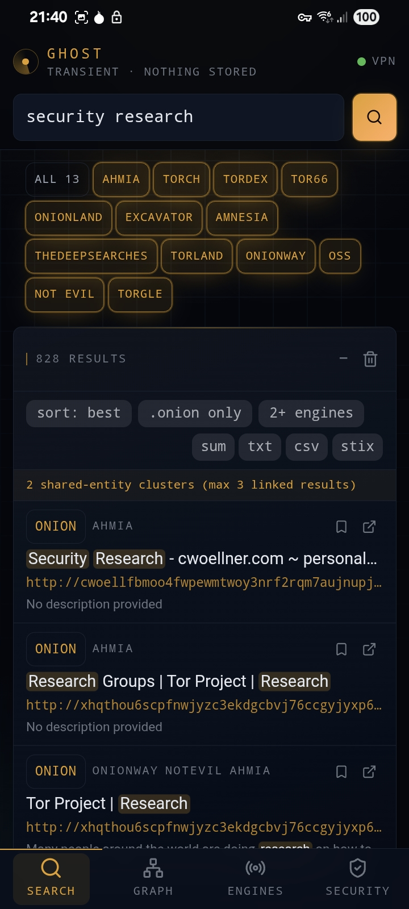
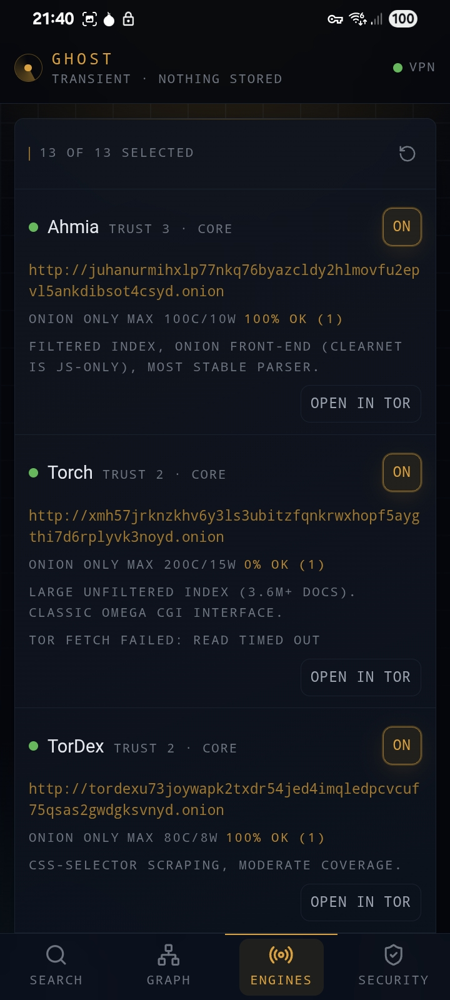
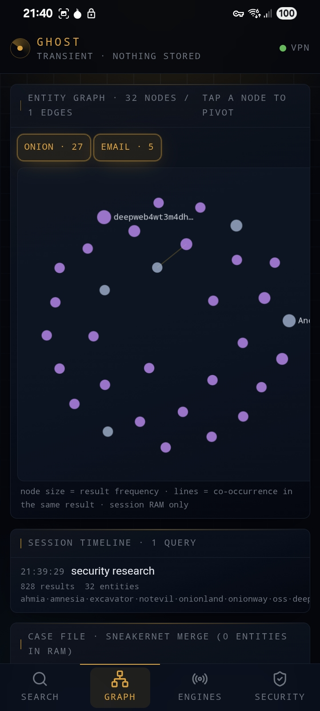
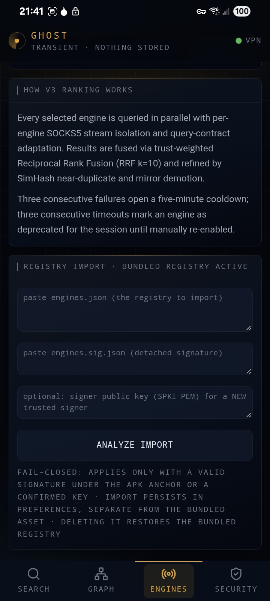
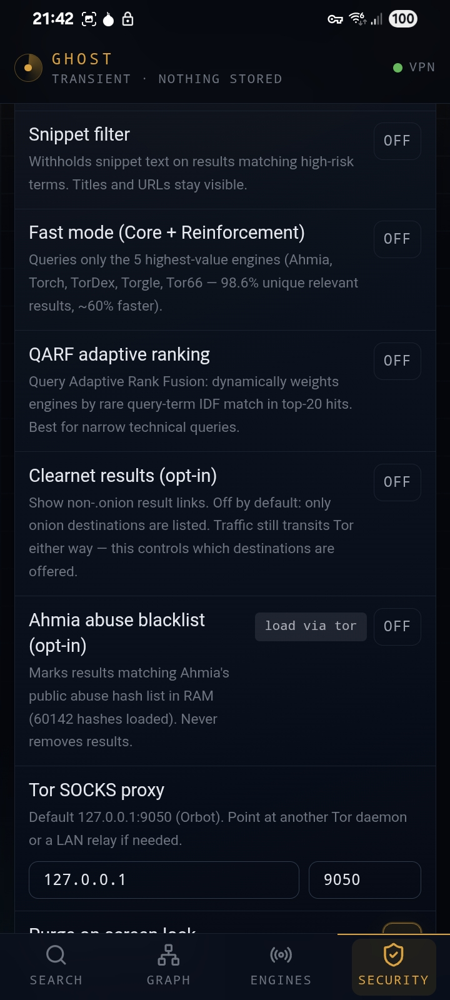

# Ghost — Transient Onion Search Aggregator

A stateless Android meta-search client for onion search engines. Built for
researchers, journalists, and investigators who need fast, transient dark-web
lookups without leaving a forensic trace on the device.

> **Status:** v4.1.0 released. [Download APK](https://codeberg.org/sookoothaii/digital-spyglass-android/releases/tag/v4.1.0) — SHA-256 `51d98d1953cd6e471121fce3ac7b9d4d3240da74d0b0373de5ea0e9c0479044d`

## About

Ghost is a privacy-first, RAM-only onion search aggregator. It queries 13
public `.onion` search engines in parallel, deduplicates and ranks the results,
and hands off links to Tor Browser via external intent. The app never renders
remote HTML, never stores queries or results to disk, and has no backend,
no telemetry, no accounts, and no ads.

Everything lives in RAM and dies with the app process. Three explicit purge
triggers wipe the session: panic wipe, screen lock, and app exit. Normal
app switching (HOME key) preserves the session for multitasking.

v4.1.0 adds an opt-in investigator workbench — same RAM-only, backend-free
guarantees:

- **Entity graph + session timeline** — extracted entities (`.onion` hosts,
  PGP fingerprints, BTC/XMR addresses, e-mails) correlated across results
  on `/graph`
- **Case files** — hash-chained, encrypted export/import (`ghost-case-v1`)
  with last-write-wins merge for sneakernet hand-offs
- **Personas** — engagement-posture presets (hostile / free / curious)
- **Entity enrichment** — BIP-173/350 bech32 verification, XMR shape
  checks, address-reuse clustering, PGP fingerprint cross-host detection
- **Tracking-strip** — tracker parameters stripped when opening result links
- **Self-check panels** — "am I leaking" self-test, verify-this-build, and
  an honest "what Ghost does not protect" panel

```text
[Query] → [Parallel fetch to 13 onion engines via Tor SOCKS5]
        → [Per-engine HTML parser]
        → [Aggregator: dedupe by URL, rank by frequency + engine trust]
        → [Virtual list in RAM only]
        → [Tap link → external intent → Tor Browser]
```

## Screenshots

<p>
  
  
  
  
  
</p>

## Requirements

- Android 7.0+ (API 24)
- [Orbot](https://orbot.app/) in VPN mode
- [Tor Browser for Android](https://www.torproject.org/download/#android) (for opening result links)

## Install

### Option 1: Direct APK (fastest)

1. Download `ghost-v4.1.0-release.apk` from the
   [Codeberg Release](https://codeberg.org/sookoothaii/digital-spyglass-android/releases/tag/v4.1.0)
2. Verify the SHA-256 checksum: `51d98d1953cd6e471121fce3ac7b9d4d3240da74d0b0373de5ea0e9c0479044d`
3. Enable "Install from unknown sources" in Android settings
4. Sideload the APK

### Option 2: Build from source

```sh
git clone https://codeberg.org/sookoothaii/digital-spyglass-android.git
cd digital-spyglass-android
bun install --frozen-lockfile
bun run build:mobile
bunx cap sync android
cd android && ./gradlew assembleRelease
```

Release APK: `android/app/build/outputs/apk/release/app-release.apk`

### Option 3: F-Droid

Ghost is listed in the official F-Droid repository as
`org.darknetcrawler.mobile` — no custom repository needed. The fdroiddata
recipe uses `Binaries:` + `AllowedAPKSigningKeys`: F-Droid rebuilds the APK
byte-identically and distributes the upstream-signed binary.

Submission status and self-hosted-repo instructions:
[docs/FDROID_SETUP.md](docs/FDROID_SETUP.md)

## Tor / VPN requirement

**Orbot must run in VPN mode.** The app checks `TRANSPORT_VPN` on all active
networks and blocks all queries with a non-dismissible overlay if no VPN is
detected. This is a hard gate, not a warning.

1. Install [Orbot](https://orbot.app/) and
   [Tor Browser for Android](https://www.torproject.org/download/#android)
2. Start Orbot → choose **VPN Mode**
3. Make sure Ghost is included in Orbot's VPN app list
4. The app unlocks automatically when the VPN is up

`.onion` requests use a custom SOCKS5 client connecting to Orbot at
`127.0.0.1:9050` with `ATYP=DOMAINNAME` for remote DNS via Tor. This bypasses
all system DNS (Pi-hole, Google, Cloudflare, ISP) and works independently
of the user's DNS configuration.

## Engine list

13 onion search engines are registered:

| Engine | Note |
| --- | --- |
| Ahmia | Filtered index, anti-bot token, most stable parser |
| Torch | Large unfiltered index, address rotates |
| TorDex | Uncensored index, moderate coverage |
| Not Evil | Pure HTML/PHP, no JS, no tracking |
| Tor66 | Category directory + keyword search, captcha-free |
| OnionLand | Onion + I2P indexing, ad-heavy pages |
| Excavator | Crawler-based, moderate coverage |
| Amnesia | Privacy-focused engine |
| TheDeepSearches | Deep-web focused |
| Torland | General onion index |
| Onionway | General onion index |
| OSS | OnionSearchServer, math captcha (POST + cookie flow) |
| Torgle | Ad-free gateway, math captcha, trust 2 |

A circuit breaker skips an engine for 5 minutes after 3 consecutive failures.
Cooldowns live in RAM only and reset with the app.

The engine list is a signed registry: `engines.json` carries an RSA-PSS
signature verified at runtime against the APK signing key, with sequence
numbers and rollback protection — tampered or replayed registries are
rejected. User-imported registries apply only when their detached signature
verifies under the anchor key or an operator-confirmed trusted key.
Signed `mirrors` entries provide breaker-aware failover to alternate
endpoints.

## Privacy

- No data collected, stored, or transmitted to any server
- No query history, no result cache, no database
- Queries and results exist only in RAM during the active session
- Three purge triggers: panic wipe, screen lock, app exit
- Ten non-sensitive preference keys persist across sessions (`ghost.prefs.v1`):
  engine selection, snippet filter, VPN requirement, Tor SOCKS host/port,
  paranoid/fast/QARF/blacklist toggles, and the consent flag — reset to
  un-acknowledged on every start. No query or result content is persisted.
- Consent gate with 18+ verification, shown every session

Full details: [docs/PRIVACY_POLICY.md](docs/PRIVACY_POLICY.md)

## Security controls

| Control | Implementation |
| --- | --- |
| Zero persistence | `QueryClient` with `gcTime: 0`, `staleTime: 0`; no `localStorage` for search data |
| Screen-off purge | `PianoScreenPlugin` receives `ACTION_SCREEN_OFF`, fires JS event, session is wiped |
| Atomic panic wipe | Purges Tor cookie jar, WebView cache/storage and preferences, zero-overwrites app dirs, `finishAndRemoveTask`, process exit; PanicKit responder included |
| VPN gate | Non-dismissible overlay; queries blocked unless VPN transport is up |
| External content | Links open via `AppLauncher.openUrl` to Tor Browser; never rendered in-app |
| Screenshot block | `FLAG_SECURE` on `MainActivity` window |
| Backup exfiltration | `android:allowBackup="false"` + data extraction rules |
| Release hardening | R8 minify + shrinkResources, ProGuard strips `Log.d/v/i` |
| Transport isolation | Custom SOCKS5 client, RFC 1929 auth, fail-closed — never falls back to a shared no-auth circuit |
| Onion integrity | v3 `.onion` checksum validated cryptographically (SHA3-256 per rend-spec-v3); canonical registry flags vanity-prefix spoof clones |
| Redirect policy | v3-onion validation on every hop; `.onion` → clearnet redirects blocked; `Sec-Fetch-Site` transitions per hop |

## Verified claims

Every security statement maps to a reproducible check in
[SECURITY.md](SECURITY.md) — test commands, expected outputs, and the
measured results (253 Vitest + 15 JUnit including a local-socket SOCKS5
protocol harness, zero `Log`/`PrintStream` calls in the release DEX, and a
real-device logcat leak test with 0 canary/`.onion`/query/cookie hits).

Independent review is welcome and structured: [REVIEW.md](REVIEW.md) is an
atomic pass/fail checklist covering protocol enforcement, threat-model
assumptions, reproducible-build verification, onion-registry provenance, and
a device test matrix. `INCONCLUSIVE` is a valid result — an untestable claim
is itself a finding.

## Tech stack

React 19 + Vite, TanStack Router + Query, Tailwind CSS v4 with OKLCH semantic
tokens, Capacitor 8 for Android packaging, TanStack Virtual, Sonner.

## Project structure

```text
src/
  components/app/     # Mobile-first UI, shell, VPN gate, disclaimer
  lib/
    ghost/            # Engines, parser, orchestrator, circuit breaker, types
    platform/         # Capacitor bridge, native helpers, transport detection
    store/            # Ghost context, settings, purge logic
  routes/             # / (search), /engines, /security, /graph
  styles.css          # OKLCH semantic design tokens
android/              # Capacitor Android project (native plugins, Gradle)
android-res/          # Manifest/res hardening inputs
mobile/               # APK-only SPA entry (index.html + main.tsx)
vite.mobile.config.ts # APK build config (no SSR)
```

## License

GPL-3.0-or-later — see [LICENSE](LICENSE). Releases up to and including
v4.0.1 were distributed under the MIT License (archived in
[LICENSE-MIT.txt](LICENSE-MIT.txt)); from v4.1.0 onward the project is
GPL-3.0-or-later.

The source code is publicly available for independent security audit. Anyone
can verify that no data is collected, no telemetry is sent, and no content is
stored persistently.

## Official channels

Canonical releases and sources:

- Codeberg: https://codeberg.org/sookoothaii/digital-spyglass-android
- F-Droid: org.darknetcrawler.mobile (upstream-signed APK, verified
  reproducibly against the Codeberg release binary)
- Release APKs are signed with the key whose certificate SHA-256 is
  `0295bf53d9abe8621e41510cdc1bd8dcaf992745621a6bcff33eeb6f3f870106`
  (`apksigner verify --print-certs`).

Builds outside these channels are not from us.

## Disclaimer

This is a research tool. Search results come from public onion search engines
and are not filtered. The app does not host, produce, or endorse any content.
Users are responsible for complying with their local laws.

The developer is not affiliated with The Tor Project and does not operate any
Tor infrastructure. The app is a client that uses the Tor network via Orbot
for transport.

Full disclaimer and limitation of liability: [DISCLAIMER.md](DISCLAIMER.md)

## Security

If you discover a security vulnerability, please report it responsibly —
see the contact paths in [SECURITY.md](SECURITY.md). Do not open a public
issue describing the vulnerability.

## Contributing

By submitting a pull request, you agree to the
[Contributor License Agreement (CLA)](CLA.md). The project is
GPL-3.0-or-later licensed; contributions are incorporated under the same
license.
